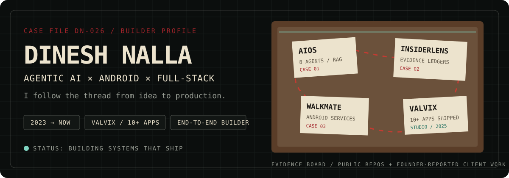
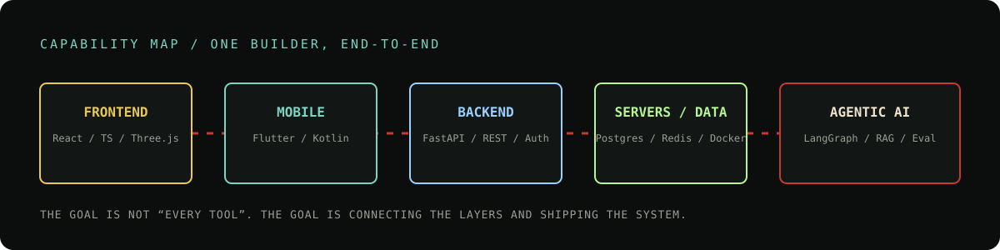
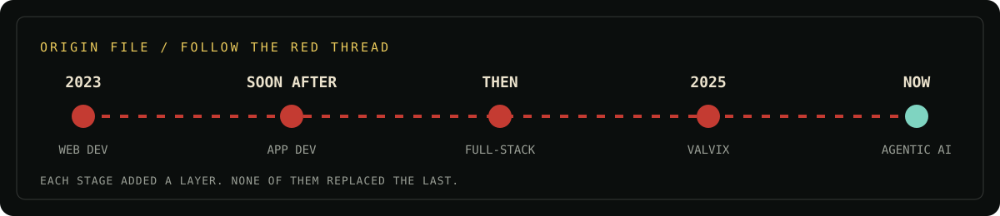
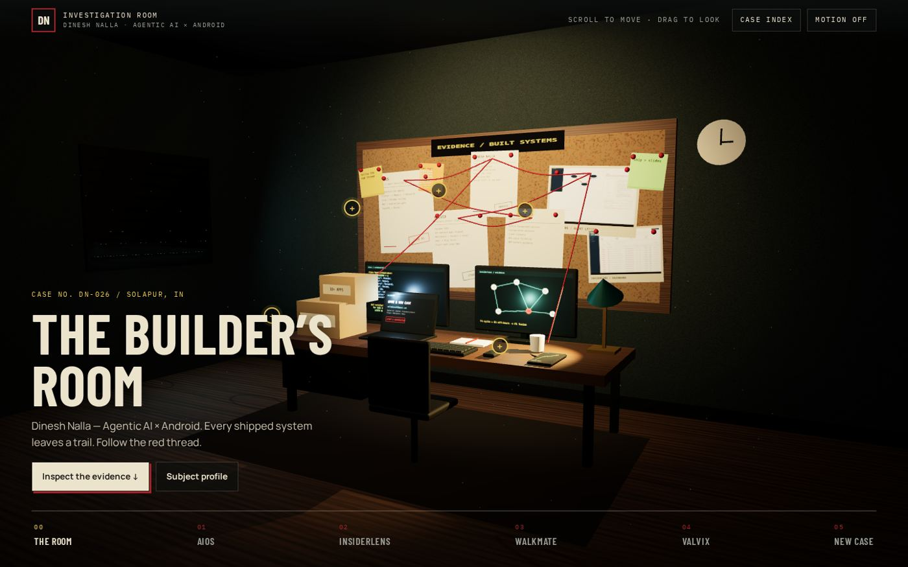
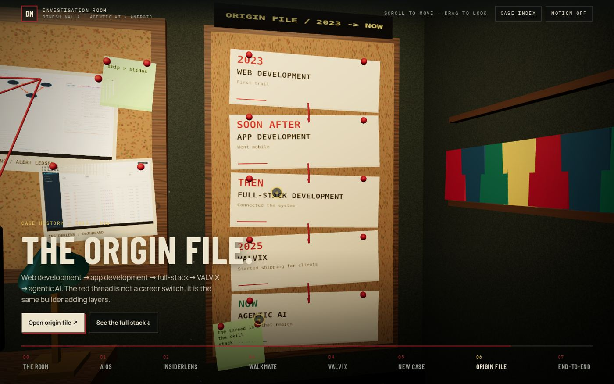
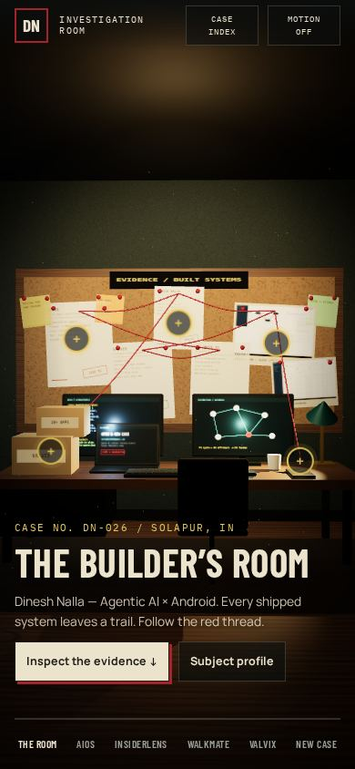
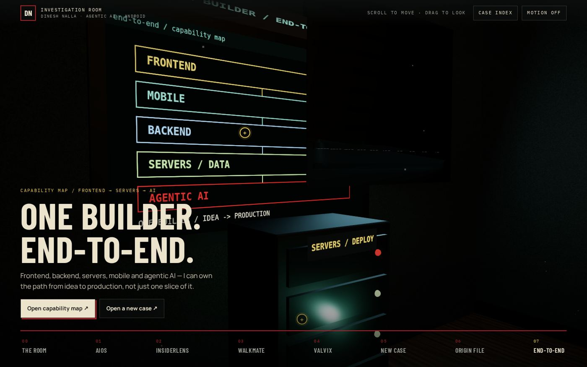

<picture>
  <source media="(prefers-color-scheme: dark)" srcset="profile/assets/hero-dark.svg">
  <source media="(prefers-color-scheme: light)" srcset="profile/assets/hero-light.svg">
  
</picture>

# Dinesh Nalla — Builder's Room

**Agentic AI × Android × Full-stack.** I started with web development in 2023, moved into apps, then full-stack delivery, co-founded VALVIX in 2025, and now build agentic AI systems. I like work where the UI, mobile lifecycle, backend, data and deployment are treated as one connected system — not separate tickets.

This repository contains the source for my **3D investigation-room portfolio**, a GitHub-ready animated profile README, and an evidence-based audit of the skills visible in my public repositories.

| | |
|---|---|
| **Name** | Dinesh Nalla |
| **Base** | Solapur, Maharashtra, India |
| **Current focus** | Production-focused agentic AI systems, Android/Flutter apps, full-stack delivery |
| **Studio** | Co-Founder & Lead Flutter Developer, **VALVIX** · 2025–Present · 10+ Android apps shipped |
| **Education** | B.Tech, Computer Engineering · VVP Engineering College · 2025–Present |
| **Contact** | [nalladinesh53@gmail.com](mailto:nalladinesh53@gmail.com) · [GitHub](https://github.com/nalla-dinesh) · [LinkedIn](https://www.linkedin.com/in/dinesh-nalla-6037533b1) |

> **Evidence rule:** public repositories are used as engineering evidence. Client work under NDA is labelled founder-reported. Synthetic benchmarks and scripted demos are not presented as real-world accuracy or live production traffic.

---

## 01 / What I build

I am most useful when a product needs more than a screen. My public work clusters around:

- **Agentic AI systems** — multi-agent orchestration, RAG, model routing, evaluation, hallucination checks and explainable outputs.
- **Android / Flutter apps** — foreground services, GPS filtering, offline-first data, local persistence, crash recovery and Play Store delivery.
- **Backend & data systems** — FastAPI services, PostgreSQL, Redis, Supabase, Firebase Auth, Docker, graph analysis and role-based applications.
- **Frontend & interactive web** — React, TypeScript, Vite, Three.js, WebGL and responsive interfaces.

The portfolio turns that into an investigation room: projects are case files, the journey is an origin file, and the capability map connects the layers end-to-end.

<picture>
  <source media="(prefers-color-scheme: dark)" srcset="profile/assets/stack-map.svg">
  
</picture>

## 02 / Skills → public evidence

These are not proficiency percentages. They are the technologies and system concerns I can point to in public repositories.

| Layer | Skills / tools | Where to inspect |
|---|---|---|
| **Agentic AI** | LangChain, LangGraph, Groq / Llama 3.3, Ollama, ChromaDB, RAG, hallucination detection, evaluation | [`AIOS`](https://github.com/nalla-dinesh/AIOS) |
| **Backend / data** | FastAPI, SQLAlchemy, PostgreSQL, Redis, Alembic, Docker, NetworkX, explainable rule engines | [`insiderlens`](https://github.com/nalla-dinesh/insiderlens) |
| **Android / Flutter** | Dart, Flutter, Kotlin foreground service, Riverpod, SQLite / Drift, GPS filtering, offline-first flows | [`walkmate-v2`](https://github.com/nalla-dinesh/walkmate-v2), [`kajibook`](https://github.com/nalla-dinesh/kajibook) |
| **Full-stack product apps** | JavaScript, Supabase, Firebase Auth, admin / counter / farmer role apps, hosted smoke tests | [`queuekisan-working-updated`](https://github.com/nalla-dinesh/queuekisan-working-updated) |
| **Frontend / 3D web** | React, TypeScript, Vite, Three.js, custom WebGL shaders, single-file builds | [`insiderlens`](https://github.com/nalla-dinesh/insiderlens), [`mashru-2035`](https://github.com/nalla-dinesh/mashru-2035), this portfolio |
| **Studio delivery** | Idea → build → Play Store, Android apps across healthcare, fitness, retail and business | [VALVIX](https://valvix.vercel.app) · founder-reported, NDA work |

### GitHub snapshot · 2026-10-29

- **15 public repositories** on [`nalla-dinesh`](https://github.com/nalla-dinesh).
- Primary-language repository counts: **Dart 4 · Python 3 · JavaScript 3 · HTML 3 · CSS 1 · unspecified 1**.
- Language bytes include generated Flutter platform scaffolding, so they are **not** used as a skill percentage.
- Full methodology, repository inventory and caveats: [`docs/github-audit-2026-10-29.md`](docs/github-audit-2026-10-29.md).

## 03 / Featured case files

### AIOS — agentic AI operating system
**Case 01.** An eight-agent system built around LangChain / LangGraph, Groq-hosted Llama 3.3, Ollama fallback, ChromaDB retrieval, hallucination detection, PostgreSQL / Redis and Docker.  
**What it demonstrates:** agent orchestration, RAG, routing, evaluation and service integration.  
**Honesty note:** the portfolio replay is scripted; repository claims about tests/coverage are not repeated here unless independently verified.  
→ [Repository](https://github.com/nalla-dinesh/AIOS)

### InsiderLens — explainable insider-trading ledger
**Case 02.** FastAPI + SQLAlchemy + PostgreSQL backend, React / Vite / Tailwind frontend, Cytoscape graph views, NetworkX analysis, rule-based scoring and evidence trails.  
**What it demonstrates:** full-stack architecture, explainability, graph analysis and testable rules.  
**Honesty note:** precision/recall/F1 figures in the repo are based on synthetic ground truth, not real-world detection accuracy.  
→ [Repository](https://github.com/nalla-dinesh/insiderlens)

### WalkMate v2 — Android location reliability
**Case 03.** Flutter UI with a Kotlin foreground service, Haversine distance, GPS filtering, OEM battery guidance, crash recovery, Riverpod and local persistence.  
**What it demonstrates:** mobile lifecycle engineering, background execution and offline-first reliability.  
→ [Repository](https://github.com/nalla-dinesh/walkmate-v2)

### VALVIX — freelancing studio
**Case 04.** Co-founded in 2025. Lead Flutter Developer. 10+ Android apps shipped across healthcare, fitness, retail and business, from idea to Play Store delivery.  
**What it demonstrates:** client delivery, mobile product execution and end-to-end ownership.  
**Honesty note:** client apps are under NDA, so counts are founder-reported and private source code is not shown.  
→ [VALVIX](https://valvix.vercel.app)

### KajiBook — offline billing
A Flutter billing app with integer-paise money handling, FIFO allocation, Drift, Riverpod and go_router.  
**What it demonstrates:** offline-first data modelling and careful financial arithmetic.  
→ [Repository](https://github.com/nalla-dinesh/kajibook)

### QueueKisan — role-based queue system
Admin, counter and farmer applications with Supabase and Firebase Auth.  
**What it demonstrates:** multi-role product flows and hosted smoke-test documentation.  
**Hygiene note:** `.env` paths are visible in the public tree. Do not assume they are safe; verify and rotate any real keys before promoting the repo.  
→ [Repository](https://github.com/nalla-dinesh/queuekisan-working-updated)

## 04 / Journey

<picture>
  <source media="(prefers-color-scheme: dark)" srcset="profile/assets/journey.svg">
  
</picture>

1. **2023 — Web development.** Started with interfaces and the web platform.
2. **Soon after — App development.** Moved into Android / Flutter product work.
3. **Then — Full-stack.** Connected frontend, backend, databases and deployment.
4. **2025 — VALVIX.** Co-founded a freelancing studio and shipped 10+ Android apps.
5. **Now — Agentic AI.** Building systems where models, tools, data and evaluation work together.

Each stage added a layer. None of them replaced the last.

## 05 / Experience, education and publication

| When | What |
|---|---|
| **2025–Present** | **Co-Founder & Lead Flutter Developer, VALVIX** — freelancing startup; 10+ Android apps shipped; healthcare, fitness, retail and business domains. |
| **Jul–Aug 2026** | **Android App Development Intern, Dominal Technologies** — 1.5 months. |
| **2024** | **Flutter Development Intern, DK Technos**. |
| **2025–Present** | **B.Tech, Computer Engineering**, VVP Engineering College. |
| **2024** | Publication: **“Your Home Our Care”**, IJSRC 7(6). |

## 06 / This portfolio

The site is a scroll-driven 3D investigation room with **eight stations**:

1. Room entrance  
2. AIOS case file  
3. InsiderLens case file  
4. WalkMate case file  
5. VALVIX studio wall  
6. Contact / let's build the next system  
7. **Origin File** — 2023 → now journey  
8. **End-to-end** — capability map

It uses React 19, TypeScript, Vite, Three.js, Lenis, Vitest and Playwright. Motion can be disabled, reduced-motion is respected, and a static poster fallback exists for devices that cannot render WebGL.

<details>
<summary><strong>Visual evidence — room, origin file and capability map</strong></summary>

| Investigation room | Origin file |
|---|---|
|  |  |

| Mobile room | Capability map |
|---|---|
|  |  |

</details>

### Quick start

```bash
npm ci
npm run dev
```

### Checks and build

```bash
npm run check       # repo safety + TypeScript
npm test            # unit/content tests
npm run test:e2e    # production build + Playwright browser tests
npm run build       # emits dist/index.html
npm run preview     # serve the production build locally
```

Or run everything:

```bash
npm run verify
```

### Deploy

This repo is **Vercel-ready**. Push it to GitHub, import the repo in Vercel, and deploy. `vercel.json` already sets the build command and output directory. Exact steps: [`docs/vercel-github.md`](docs/vercel-github.md).

## 07 / Repository map

```text
.
├── src/                    # portfolio app: room, data, components, styles
├── tests/                  # Vitest content tests + Playwright E2E
├── profile/                # copy this folder's README.md into nalla-dinesh/nalla-dinesh
│   ├── README.md
│   └── assets/             # self-contained animated SVGs
├── docs/                   # audit, architecture, deployment, sources, customization
├── scripts/                # repository validator
├── .github/workflows/      # CI
├── vercel.json             # Vercel build/deploy config
├── DESIGN_NOTES.md
├── CONTRIBUTING.md
├── SECURITY.md
└── LICENSE
```

### Use the animated GitHub profile README

1. Create or open the special repository **`nalla-dinesh/nalla-dinesh`**.
2. Copy [`profile/README.md`](profile/README.md) to that repository's root `README.md`.
3. Copy [`profile/assets/`](profile/assets/) to that repository's `assets/` folder.
4. Commit. The SVG animations are GitHub-compatible and do not use JavaScript.

The profile README is intentionally separate from this project README so the portfolio repo and the GitHub profile can evolve independently.

For exact push commands, see [`docs/publishing.md`](docs/publishing.md).

## 08 / Engineering principles

- **Evidence over hype.** Skills are tied to repositories or clearly labelled founder-reported work.
- **One connected system.** UI, mobile lifecycle, backend, data and deployment are designed together.
- **Accessible motion.** Reduced-motion support, motion toggle, keyboard-friendly dialogs and static fallback.
- **Mobile-native scrolling.** Touch devices keep native scrolling; case files scroll independently without trapping the page.
- **Production-focused defaults.** Strict TypeScript, content tests, browser tests, CI, Vercel config, relative asset base and documented deployment.
- **No fake metrics.** Language bytes are not proficiency. Synthetic benchmarks are not real-world accuracy.

## 09 / Documentation

- [GitHub audit — 2026-10-29](docs/github-audit-2026-10-29.md)
- [Architecture](docs/architecture.md)
- [Deployment](docs/deployment.md)
- [Vercel via GitHub](docs/vercel-github.md)
- [Content sources and honesty rules](docs/content-sources.md)
- [Customization guide](docs/customization.md)
- [Publishing to GitHub](docs/publishing.md)
- [Security](SECURITY.md)
- [Contributing](CONTRIBUTING.md)

## License

Code is released under the [MIT License](LICENSE). Personal identity content, résumé facts, photographs, project names and brand assets are **not** granted for reuse as someone else's identity or portfolio. See [CONTENT_NOTICE.md](CONTENT_NOTICE.md).
